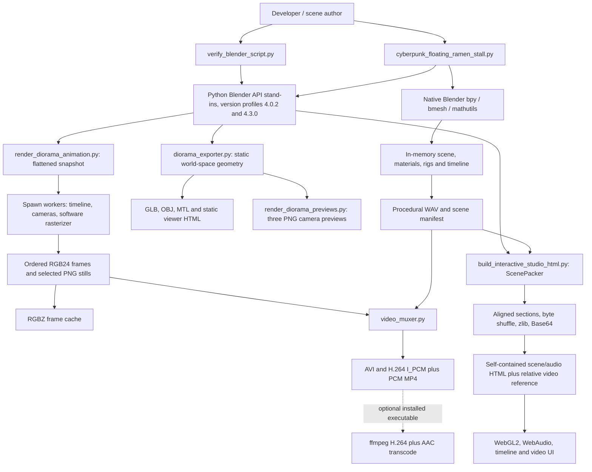
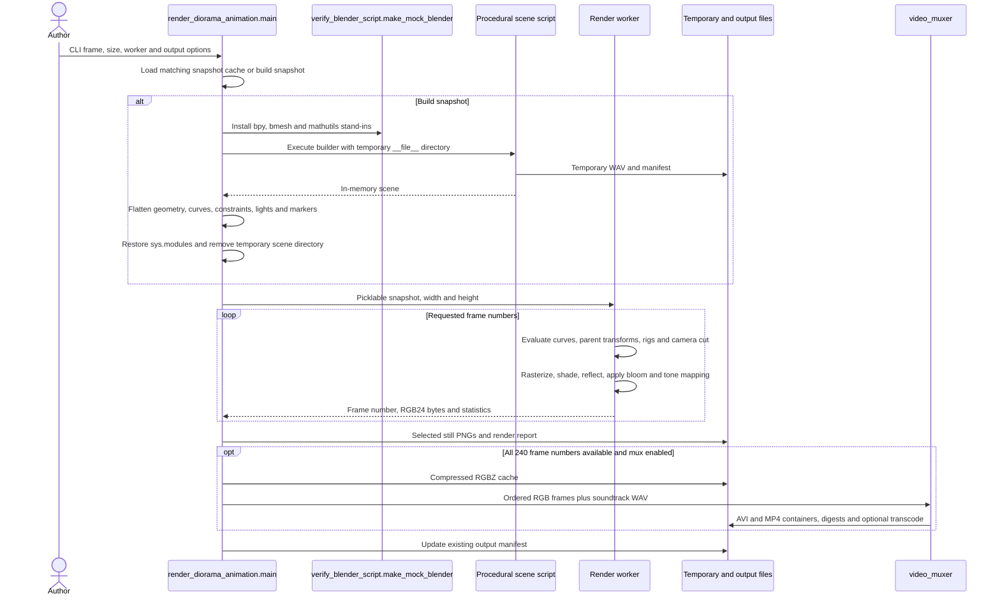

# Architecture: Cyberpunk Floating Ramen Stall

Reviewed 2026-11-08 against the local checkout. This is a procedural scene and media toolchain, with a native Blender entry point and separate Python implementations for scene evaluation, serialization, rendering and browser playback. Native Blender compatibility and full-render visual quality were not exercised in this pass.

## System context and data flow



The mock runtime is a Python behavioral test double. Its version profiles do not launch native Blender installations. The software evaluators implement selected modifier, spline, material and animation semantics. They are not a complete independent implementation of Blender.

## Animation and export sequence



## Modules and entry points

| Module | Implemented responsibilities |
| --- | --- |
| `cyberpunk_floating_ramen_stall.py:4883-5017` | Native Blender builder. Clears the existing scene, creates collections, geometry, shader graphs, lights, cameras, rigs and animation, synthesizes audio, validates required cameras and timeline markers, locks transforms/F-curves for batch rendering, and writes the manifest. Running it changes scene state and output files. |
| `verify_blender_script.py:944-1684,2649-2740` | Supplies mock Blender data structures and API schemas, scans/AST-parses the scene script, executes both mock version profiles, and invokes the downstream generation/validation tracks. Its full CLI performs substantial file generation. |
| `diorama_exporter.py:71-1133` | Affine math, spline/tube tessellation, selected CPU modifier handling, material extraction, hierarchy evaluation, world-space normals, and aligned glTF binary/OBJ/MTL serialization. Static geometry is already in world space. |
| `diorama_exporter.py:1140-1902` | Emits the separate static interactive viewer HTML. |
| `render_diorama_previews.py:534-832` | Triangle rendering, depth, lighting, reflections, bloom, filmic mapping and three fixed camera preview exports. PNG encoding uses only struct and zlib. |
| `render_diorama_animation.py:288-471,854-1257,2037-2291` | Prepared F-curves, path lookup, scene snapshot, fractional-frame hierarchy/constraint/rig evaluation, worker rendering and driver orchestration. |
| `video_muxer.py:55-190,198-514,530-572` | RGBZ cache, PCM WAV loader, exact sample slicing, bottom-up padded BGR AVI, bit writer and H.264 I_PCM IDR samples, MP4 sample tables, optional ffmpeg, and cache-driven remux CLI. |
| `build_interactive_studio_html.py:335-691,1407-2077` | Timeline/scene evaluator, geometry/material/rig packer, aligned CPKS section table with SHA-256 metadata, HTML substitutions, audio embedding and manifest update. The later HTML_TEMPLATE contains JavaScript and shader programs for playback. |
| `.github/workflows/ci.yml` | Python 3.12 job invoking the full mock-runtime verifier. The existing job does not install or launch native Blender. |
| `tests/test_audit_pipeline.py` | Fast unit and integration suite using tiny fixture geometry and media in temporary directories. |

No package manifest or requirements file exists in this checkout. The Python export and binary helpers import the standard library. The scene builder requires Blender-provided modules. Optional transcoding requires ffmpeg. Browser playback requires WebGL2/WebAudio support and user interaction for audio.

## State ownership and lifecycle

The native builder owns mutable Blender scene state. The mock paths install temporary entries in sys.modules. Animation snapshot construction restores those module entries in finally and directs generated intermediate audio/manifest files to a temporary directory. The interactive-studio builder also restores module entries, but its normal scene execution writes audio/manifest next to the scene source.

Flattened snapshots contain dictionaries, geometry buffers, prepared F-curves, paths, parent/constraint references, camera markers and lights. Each spawned worker owns a render context in its process. The driver retains frame bytes by frame number before ordering and muxing them. There is no service, database, user account or remote model API in these paths.

Persistent state consists of saved scene manifests, render reports, geometry, audio, videos, HTML and optional snapshot/RGBZ caches. The snapshot cache is pickle and must be treated as a trusted local artifact because loading it executes Python deserialization. The current source-hash cache key covers the scene script, not every evaluator source file. The native manifest writer measures available output files but also carries previous phase-7 artifact records forward when the files are absent, without a historical/provenance label. The CPKS header stores section digests, but its current Python parser does not enforce them. See TECH_DEBT.md.

The browser keeps camera, timeline, playback and audio state in JavaScript/WebGL resources. Embedded CPKS and WAV permit scene/audio playback without external asset downloads. The video deck references a separate relative MP4, so video playback requires that file alongside the HTML.

## Verification and evidence

Run the new small-fixture suite from the repository root:

```sh
python -B -m unittest discover -s tests -p test_audit_pipeline.py -v
```

The suite has 23 tests. It checks affine inverse composition, tube topology, F-curve interpolation, parent animation and camera cuts, CPKS section/shuffle roundtrips, template substitution, PNG CRC/pixels, actual GLB and OBJ output, RGBZ roundtrips, PCM slicing, BGR padding, WAV restrictions, bit coding and independently reopened AVI/MP4 sample offsets. The additional checks execute the scene builder against the mock API with `__file__` redirected to a temporary directory and inspect BT.709 video metadata through an independent SPS/VUI parser. Generated WAV and manifest files remain temporary. The optional-transcoder test mocks process discovery and starts no child process.

This pass ran those tests successfully. It did not render 240 frames, execute the full verifier, rebuild tracked media, launch native Blender, check browser visuals/audio, or certify every codec/glTF implementation detail. Saved manifest counts and README screenshots describe existing artifacts and are not fresh runtime evidence. In the full verifier, absent full-length video outputs trigger a three-frame synthetic muxer check followed by literal historical size/digest records under the absent original filenames. That branch is not verification of those missing artifacts. TECH_DEBT.md item 5 proposes an explicit incomplete-result failure after the fixture checks.

Concurrent source changes were observed during this audit, including shader-group handling, render-lock validation and BT.709 video metadata. Source references were refreshed after rereading these files. The suite also covers one mock scene-builder execution in a temporary directory. It does not establish native Blender or full-verifier success.
