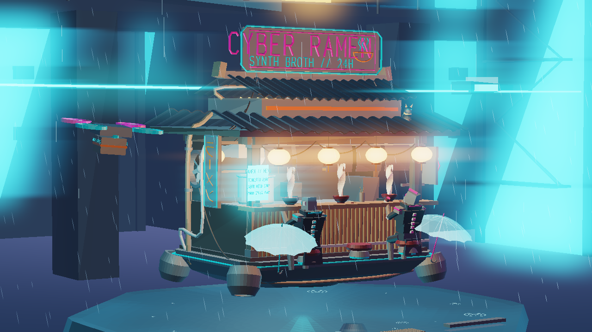
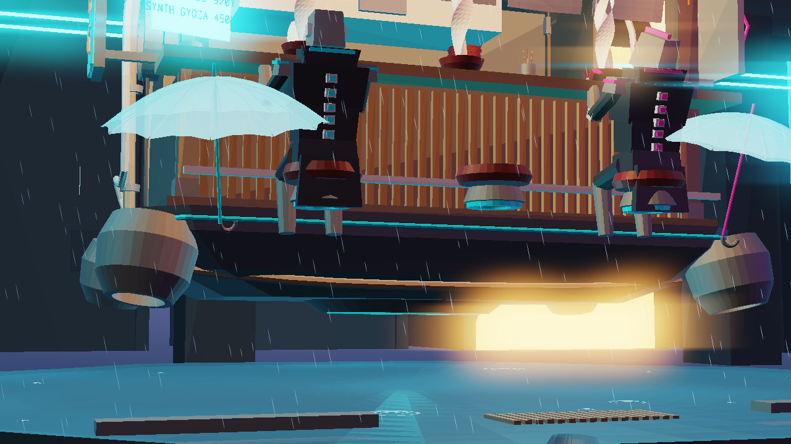
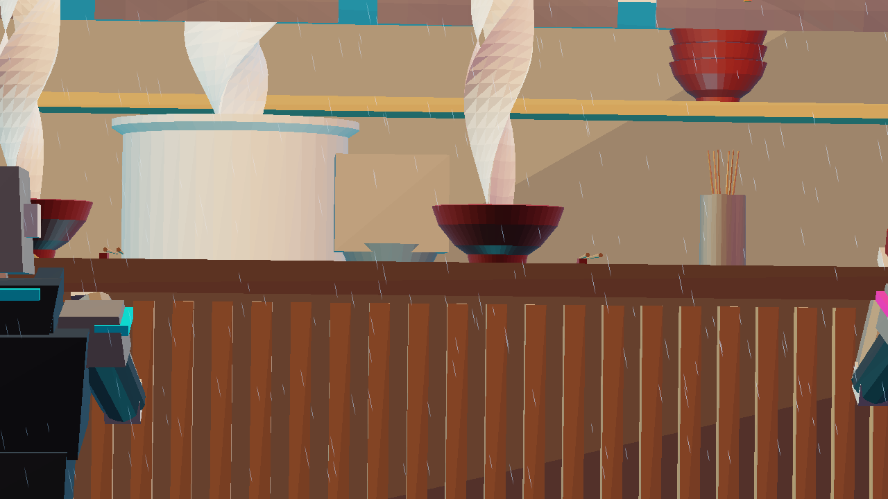
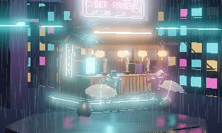
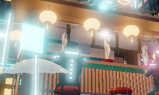
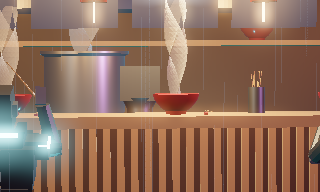

# Cyberpunk Floating Ramen Stall — Procedural Blender 4.x, glTF 2.0 & WebGL2 Engine

[](https://github.com/vanovri/cyberpunk-floating-ramen-stall/actions)
[](https://github.com/vanovri/cyberpunk-floating-ramen-stall/releases/tag/v1.0.0)
[](LICENSE)
[](#architecture--32-track-pipeline)

A **100% self-contained procedural 3D diorama generation, binary glTF 2.0 serialization, pure-Python software Z-buffer rendering, 240-frame RIFF/AVI & ISO-BMFF `.MP4` audio-video muxer, and interactive 240-frame WebGL2 + WebAudio studio pipeline** targeting **Blender 4.0–4.3 (`bpy` & `bmesh`)** and standard Python 3.12+ with **zero external 3D assets, textures, HDRIs, or third-party Python packages**.

---

## Pure-Python Software Z-Buffer Multi-Camera Previews (`1280×720`)

| Camera 1 — `85mm` Orbital Establishing (`F1–F80`) | Camera 2 — `50mm` Low-Angle Hero (`F81–F160`) | Camera 3 — `105mm` Counter Macro (`F161–F240`) |
| :---: | :---: | :---: |
|  |  |  |
| `std_luminance = 60.08`, `233,340` neon bloom px | `std_luminance = 63.59`, `128,282` neon bloom px | `std_luminance = 53.81`, `123,815` neon bloom px |

---

## 240-Frame Animated Evaluator Keyframe Stills (`Tracks 25–28`)

| Frame `001` — `Cinematic_Camera_85mm` (`F1–F96`) | Frame `120` — `Cinematic_Camera_50mm_HeroLow` (`F97–F168`) | Frame `200` — `Cinematic_Camera_105mm_MacroCounter` (`F169–F240`) |
| :---: | :---: | :---: |
|  |  |  |
| `RGB SHA-256: 829e4033...` (`127,353` B) | `RGB SHA-256: 3a23a491...` (`128,923` B) | `RGB SHA-256: e7b3af89...` (`75,761` B) |

---

## Verified Scene Telemetry & Deterministic Checksums

| Metric / Subsystem | Verified Count / Value |
| :--- | :--- |
| **Blender API Compatibility** | **Blender 4.0.2 & Blender 4.3.0** (`Principled BSDF` v4 socket schema + `EEVEE_NEXT` raytracing) |
| **Total Procedural Scene Objects** | **`579` objects** across **`10` organized collections** |
| **Mesh Objects (`bmesh` + Modifiers)** | **`380` meshes** (`ARRAY`, `SOLIDIFY`, `BEVEL`, `SUBSURF`, `LATTICE`, `WAVE`, `ARMATURE`, `NODES`) |
| **Curve & 3D Text Splines (`CURVE` / `FONT`)** | **`154` curves/fonts** tessellated via Bishop parallel-transport frames |
| **Evaluated World-Space Geometry** | **`90,766` vertices / `170,840` triangles** (`238,336` verts / `345,664` indexed tris in CPKS studio) |
| **Procedural Node-Based Materials** | **`31` materials**, **`233` shader nodes**, **`240` node links** (zero external image files) |
| **Articulated Armatures & Pose Animation** | **`2` armatures** (`CyberChef_Armature` 7-bone kitchen rig + `Patron_Armature` 8-bone seated customer) |
| **Keyframe Actions & F-Curves** | **`72` Actions**, **`95` F-Curves** across a seamless **240-frame (`10.0s @ 24 fps`)** loop |
| **Cinematic Lighting & Multi-Camera Switcher** | **`14` lights** (Key/Rim/Fill, 6 lantern points, 3 spot cones, 2 chef optics) + **`3` cameras** bound via `TimelineMarkers` |
| **Blender 4.x Compositor & Geometry Nodes** | **`12` compositor nodes** (Dual Glare Fog Glow + Streaks, Mist, Lens Distortion, AgX) + **`1` `GeometryNodeTree`** |
| **Binary glTF 2.0 Export (`cyberpunk_diorama.glb`)** | **`4,589,696` bytes** (`magic = 0x46546C67`, v2, `FLOAT` positions/normals + `pbrMetallicRoughness`) |
| **240-Frame RIFF/AVI 1.0 Video (`cyberpunk_diorama_240f.avi`)** | **`46,168,654` bytes** (`240` `00db` 24-bit BGR frames + `240` `01wb` 48 kHz PCM chunks + `480` `idx1` entries, SHA-256 `61847d9d...`) |
| **240-Frame ISO-BMFF `.MP4` Video (`cyberpunk_diorama_240f.mp4`)** | **`24,160,441` bytes** (`ftyp isom`, `mdat`, `moov`, `240` H.264 `avc1` `I_PCM` IDR NAL units + `sowt` 48 kHz PCM, SHA-256 `ea4cc2e7...`) |
| **Procedural Audio (`cyberpunk_ramen_soundtrack.wav`)** | **`1,920,044` bytes** (`48,000 Hz`, 16-bit stereo PCM, `10.0s` Vangelis pad + rain + broth sizzle + Taiko) |
| **Scene Topology SHA-256 Digest** | `913d4982dd47aea080c6c8e46da75513c033aadbd699e3bdbffa5ab37c50141a` |

---

## Architecture & 32-Track Pipeline

1. **Core Blender 4.x Procedural Scene Generator ([`cyberpunk_floating_ramen_stall.py`](cyberpunk_floating_ramen_stall.py), Tracks 1–20)**:
   - **Tracks 1–5**: Cycles GPU + `BLENDER_EEVEE_NEXT` initialization, AgX High Contrast, `Principled Volume` world shader, multi-tiered floating stall hull, sine-corrugated roof tiles, procedural ramen bowls/noodles/toppings, hanging paper lanterns, catenary power cables, articulated 7-bone Cyber-Chef automaton (`CyberChef_Armature`), Geometry Nodes rain/ripples/steam (`GN_Cyber_Rain_Field`), and a 12-node Blender 4.x Compositor pipeline.
   - **Tracks 6–10**: Brutalist Neo-Tokyo megablock canyon (`08_Cyber_City_Megablock`, 8 multi-tier skyscrapers with procedural brick/voronoi night windows), elevated Maglev monorail viaduct + 3-car animated train (`F1–F240`), bi-directional flying spinner traffic with long-exposure plasma light trails, holographic Kanji billboards with scanline glitch shaders, and a 3-camera `TimelineMarkers` Director's Cut switcher.
   - **Tracks 11–20**: Seated cyberpunk patron character (`Patron_Armature` 8-bone eating/drinking cycle), interior izakaya kitchen props (slotted bamboo seiro, gyoza teppan, 12 sake bottles, digital menu), rooftop satellite dishes & solar panels, wet-asphalt reflection plane with floating debris & neon koi fish, procedural lightning flashes, programmatic 48 kHz stereo WAV soundtrack synthesis (`build_procedural_cyberpunk_soundtrack`), and deterministic SHA-256 scene manifest export.
2. **Modifier & Spline Evaluator + Binary glTF 2.0 Serializer ([`diorama_exporter.py`](diorama_exporter.py), Tracks 21–22)**:
   - Evaluates `ARRAY`, `SOLIDIFY`, `LATTICE`, `WAVE`, `ARMATURE`, and `NODES` modifiers directly onto vertex/triangle buffers in pure Python and tessellates all 154 `CURVE` and `FONT` splines using Bishop parallel-transport frames.
   - Serializes spec-compliant **glTF 2.0 Binary (`cyberpunk_diorama.glb`)**, **Wavefront (`cyberpunk_diorama.obj` + `.mtl`)**, and a self-contained **Three.js / WebGL2 3D Viewport (`cyberpunk_diorama_viewer.html`)**.
3. **Pure-Python Software Z-Buffer + Neon Bloom Renderer ([`render_diorama_previews.py`](render_diorama_previews.py), Tracks 23–24)**:
   - Zero-dependency perspective triangle rasterizer (`array('f')` depth buffer, top-left fill convention) with 14-light PBR/Phong shading, `Z = 0` wet-asphalt planar reflection pass, volumetric exponential mist, separable multi-pass Gaussian/Box Neon Bloom + horizontal anamorphic streaks, and AgX filmic tone-mapping exported directly to `.png` via `zlib`/`struct`.
4. **240-Frame Multiprocess Animation Evaluator & Binary RIFF/AVI + ISO-BMFF `.MP4` Muxer ([`render_diorama_animation.py`](render_diorama_animation.py) & [`video_muxer.py`](video_muxer.py), Tracks 25–28)**:
   - Evaluates all 95 F-curves (`BEZIER` & `LINEAR`), parent hierarchies, `PoseBone` armatures, and the 3-camera `TimelineMarker` cut across frames `1..240` (`24 fps`, `10.0s`) in parallel across CPU workers (`multiprocessing.Pool`).
   - Muxes all 240 rendered RGB frames with the 48 kHz 16-bit stereo `cyberpunk_ramen_soundtrack.wav` into both a **spec-compliant RIFF/AVI 1.0 container (`cyberpunk_diorama_240f.avi`, `46.17 MB`)** and a **spec-compliant ISO-BMFF `.MP4` container (`cyberpunk_diorama_240f.mp4`, `24.16 MB`)** wrapping valid H.264 Annex-B/AVCC `avc1` `I_PCM` IDR macroblock NAL units + `sowt` PCM audio (plus high-compression H.264+AAC `cyberpunk_diorama_240f_h264_aac.mp4`, `1.81 MB`).
5. **240-Frame Baked CPKS Binary & WebGL2 Interactive Studio ([`build_interactive_studio_html.py`](build_interactive_studio_html.py), Tracks 29–32)**:
   - Packs `238,336` vertices, `345,664` triangles, and `70` animated object tracks into a deflate-compressed **`CPKS` binary stream**, and embeds a custom WebGL2 deferred/bloom shader pipeline + WebAudio 64-bin FFT visualizer into a single zero-dependency `cyberpunk_interactive_studio.html` file.

---

## Quick Start

### 1. Run inside Blender 4.0–4.3
```bash
blender --background --python cyberpunk_floating_ramen_stall.py
```

### 2. Run Pure-Python Verification, glTF 2.0 Export, Software Renders, 240-Frame Video Muxer & WebGL2 Studio (No Blender Required)
```bash
# Execute 32-track AST + Dual Blender 4.0.2 / 4.3.0 runtime verification + glTF/OBJ export
python verify_blender_script.py cyberpunk_floating_ramen_stall.py

# Render the 3 camera views (1280x720 PNG) using the pure-Python Z-buffer + Neon Bloom rasterizer
python render_diorama_previews.py

# Evaluate & render all 240 animation frames across CPU cores and mux RIFF/AVI 1.0 + ISO-BMFF .MP4
python render_diorama_animation.py

# Build the self-contained 240-frame baked WebGL2 + WebAudio Interactive Studio HTML
python build_interactive_studio_html.py
```

---

## License

Released under the [MIT License](LICENSE). Built by [Ardhya Novri](https://ardhyanovri.my.id).
